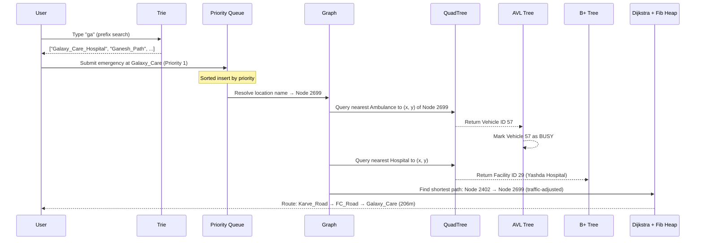

# Emergency Response Dispatch & Optimal Routing System
## Design Document v2.0

---

## 1. Project Overview

The **Emergency Response Dispatch & Optimal Routing System** is a full-stack emergency management platform that simulates real-world 911/112 dispatch operations for the city of **Pune, India**. The system combines a high-performance C engine powered by 7+ advanced data structures with a real-world OpenStreetMap data pipeline and a planned 3-dashboard web frontend.

### 1.1 Problem Statement

Emergency response systems must answer three critical questions in milliseconds:
1. **Where** is the emergency? (Location resolution)
2. **Who** is closest? (Spatial nearest-neighbor search)
3. **What** is the fastest route? (Shortest path with traffic avoidance)

This project solves all three using a carefully orchestrated set of data structures, each chosen for its optimal time complexity in the specific sub-problem it addresses.

### 1.2 Key Objectives

- Model a real city's road network as a weighted graph (3,000+ intersections, 6,600+ road segments)
- Dispatch the nearest available emergency vehicle using spatial indexing
- Calculate the fastest route while avoiding simulated traffic congestion
- Provide role-based web dashboards for Users, Admins, and Vehicle Operators

---

## 2. System Architecture

```
┌─────────────────────────────────────────────────────────────┐
│                    WEB FRONTEND (HTML/CSS/JS)                │
│  ┌──────────────┐  ┌──────────────┐  ┌───────────────────┐  │
│  │ User Portal  │  │ Admin Panel  │  │ Operator Console  │  │
│  │ (Report      │  │ (Dispatch &  │  │ (Vehicle Status   │  │
│  │  Emergency)  │  │  Monitor)    │  │  Management)      │  │
│  └──────┬───────┘  └──────┬───────┘  └─────────┬─────────┘  │
│         │                 │                     │            │
└─────────┼─────────────────┼─────────────────────┼────────────┘
          │    REST API     │                     │
          ▼                 ▼                     ▼
┌─────────────────────────────────────────────────────────────┐
│              PYTHON API SERVER (FastAPI + ctypes)            │
│  /api/search_location  /api/add_call  /api/dispatch         │
│  /api/get_queue        /api/vehicles  /api/resolve          │
└──────────────────────────┬──────────────────────────────────┘
                           │  ctypes FFI
                           ▼
┌─────────────────────────────────────────────────────────────┐
│                  C ENGINE (Shared Library / .dll)            │
│                                                             │
│  ┌─────────┐  ┌──────────┐  ┌────────┐  ┌──────────────┐   │
│  │  Graph  │  │ Dijkstra │  │  Trie  │  │ Priority     │   │
│  │ (3000   │  │ + Fib    │  │ (Auto- │  │ Queue        │   │
│  │  nodes) │  │  Heap    │  │  comp) │  │ (Sorted LL)  │   │
│  └─────────┘  └──────────┘  └────────┘  └──────────────┘   │
│  ┌─────────┐  ┌──────────┐  ┌────────────────────────────┐  │
│  │QuadTree │  │ AVL Tree │  │      B+ Tree               │  │
│  │(Spatial │  │(Vehicle  │  │   (Facility Database)      │  │
│  │ Index)  │  │   DB)    │  │                            │  │
│  └─────────┘  └──────────┘  └────────────────────────────┘  │
└──────────────────────────┬──────────────────────────────────┘
                           │  File I/O
                           ▼
┌─────────────────────────────────────────────────────────────┐
│             PYTHON DATA PIPELINE (run_pipeline.py)           │
│  OpenStreetMap → BFS Connected Graph → Traffic Simulation    │
│  → city_map.txt, facilities.txt, vehicles.txt                │
└─────────────────────────────────────────────────────────────┘
```

---

## 3. Data Structures & Their Roles

| # | Data Structure | File | Role | Time Complexity |
|---|----------------|------|------|-----------------|
| 1 | **Graph** (Adjacency List) | `graph.c` | City road network (3,000 nodes, 6,632 edges) | O(V + E) traversal |
| 2 | **Dijkstra's Algorithm** + **Fibonacci Heap** | `dijkstra.c`, `fib_heap.c` | Shortest path with traffic-weighted edges | O(E + V log V) |
| 3 | **QuadTree** | `quadtree.c` | Spatial nearest-neighbor search for vehicles & facilities | O(log N) average |
| 4 | **AVL Tree** | `avl_tree.c` | Balanced vehicle database with O(log N) lookups by ID | O(log N) search/insert |
| 5 | **B+ Tree** | `bplus_tree.c` | Facility database optimized for range queries | O(log N) search, O(N) range |
| 6 | **Trie** | `trie.c` | Location name autocomplete (prefix search) | O(K) where K = prefix length |
| 7 | **Priority Queue** (Sorted Linked List) | `queue.c` | Emergency call queue (Priority 1 processed first) | O(N) insert, O(1) dequeue |

### 3.1 How They Interact During a Dispatch



---

## 4. Data Pipeline (`scripts/run_pipeline.py`)

### 4.1 Data Source
- **OpenStreetMap** via the Overpass API
- Center: Pune, India (18.5204°N, 73.8567°E)
- Radius: 3 km
- Road types: primary, secondary, tertiary, residential

### 4.2 Pipeline Stages

| Stage | Description | Output |
|-------|-------------|--------|
| **1. Fetch** | HTTP POST to Overpass API for roads + amenities | Raw JSON |
| **2. Parse** | Extract node coordinates, way segments, and street names | In-memory graph |
| **3. BFS Connect** | Starting from the node closest to city center, BFS-expand to collect exactly 3,000 connected nodes | Guaranteed connected subgraph |
| **4. Traffic Sim** | 15% of edges receive a 3x–4x weight multiplier | Traffic-adjusted weights |
| **5. Normalize** | Map real lat/lon to a 0–100 coordinate grid (clamped) | QuadTree-compatible coords |
| **6. Snap Facilities** | Find the closest graph node for each hospital/station | Facility → Node mapping |
| **7. Spawn Vehicles** | 2 vehicles per facility + 15 random patrol units | Vehicle fleet |
| **8. Export** | Write `city_map.txt`, `facilities.txt`, `vehicles.txt` | C-compatible flat files |

### 4.3 Generated Data Files

| File | Format | Example |
|------|--------|---------|
| `data/city_map.txt` | `NODES N` then `ID Name X Y`, then `EDGES M` then `U V Weight` | `42 Karve_Road 61.2 45.3` |
| `data/facilities.txt` | `FACILITIES N` then `ID Type NodeID X Y Capacity Name` | `1 0 2699 51.9 47.9 250 Galaxy_Care` |
| `data/vehicles.txt` | `VEHICLES N` then `ID Type NodeID X Y Name` | `57 0 2699 51.9 47.9 Ambulance_57` |

---

## 5. C Backend — File Structure

```
ADS project/
├── include/
│   ├── common.h          # Shared types, enums, constants (MAX_NODES=3500)
│   ├── graph.h            # Graph (adjacency list) interface
│   ├── dijkstra.h         # Shortest path interface
│   ├── fib_heap.h         # Fibonacci Heap (priority queue for Dijkstra)
│   ├── quadtree.h         # Spatial index interface
│   ├── avl_tree.h         # Balanced BST for vehicles
│   ├── bplus_tree.h       # B+ Tree for facilities
│   ├── trie.h             # Prefix tree for autocomplete
│   └── queue.h            # Emergency priority queue
├── src/
│   ├── main.c             # Entry point, menu loop, dispatch orchestration
│   ├── graph.c            # Graph construction & file loading
│   ├── dijkstra.c         # Dijkstra + route printing (traffic-adjusted, deduped)
│   ├── fib_heap.c         # Fibonacci Heap implementation
│   ├── quadtree.c         # QuadTree with type-filtered nearest-neighbor
│   ├── avl_tree.c         # AVL Tree with vehicle status management
│   ├── bplus_tree.c       # B+ Tree with range query support
│   ├── trie.c             # Trie with prefix search + exact match
│   └── queue.c            # Sorted linked list priority queue
├── data/
│   ├── city_map.txt       # Generated road network (3,000 nodes)
│   ├── facilities.txt     # 184 real hospitals, police & fire stations
│   └── vehicles.txt       # 383 emergency vehicles
├── scripts/
│   └── run_pipeline.py    # OpenStreetMap data extraction pipeline
└── Makefile
```

### 5.1 Build Command
```bash
gcc -Wall -Wextra -std=c11 -Iinclude src/*.c -lm -o emergency_system.exe
```

### 5.2 Current Menu System (CLI)
```
1.  Add Emergency Call         → Trie autocomplete → Priority Queue
2.  Process Next Emergency     → Dequeue highest priority call
3.  Search Location            → Trie prefix search
4.  View All Vehicles          → AVL in-order traversal
5.  View All Facilities        → B+ Tree display
6.  View City Map              → Graph display
7.  Find Shortest Path         → Dijkstra between any two nodes
8.  Complete a Dispatch        → Full pipeline: Queue → QuadTree → Dijkstra
9.  Resolve Emergency          → Free vehicle (AVL status update)
10. Exit
```

---

## 6. Frontend Design — 3 Web Dashboards

### 6.1 Dashboard Roles

| Dashboard | User Role | Primary Actions | Key Data Structures Used |
|-----------|-----------|----------------|--------------------------|
| **User Portal** | Citizen / Caller | Report emergency, track status | Trie (autocomplete), Priority Queue |
| **Admin Panel** | Dispatcher / Control Room | View queue, dispatch vehicles, monitor routes | All 7 data structures |
| **Operator Console** | Vehicle Driver / Crew | View assigned mission, mark job complete | AVL Tree (status update) |

### 6.2 User Portal (`user.html`)

**Purpose**: A citizen-facing interface to report emergencies.

**Features**:
- **Emergency Type Selector**: Visual cards for Medical 🏥, Crime 🚔, Fire 🔥
- **Location Autocomplete**: Live search bar powered by the Trie — as the user types, suggestions appear instantly
- **Priority Selector**: Dropdown (Critical / High / Normal)
- **Submit Button**: Sends the emergency to the API, which enqueues it in the Priority Queue
- **Status Tracker**: After submission, shows a live status card ("Queued → Dispatched → En Route → Resolved")

**Design**:
- Clean, minimal, mobile-first layout
- Large, accessible buttons (designed for panic situations)
- Calming color palette (soft blue and white) to reduce user stress
- Micro-animations on submission (pulsing confirmation)

### 6.3 Admin Panel (`admin.html`)

**Purpose**: A command-center dashboard for dispatchers to manage the entire system.

**Features**:
- **Live Emergency Queue**: Real-time table showing all pending calls, sorted by priority. Color-coded rows (red = Critical, orange = High, green = Normal)
- **Dispatch Button**: One-click dispatch that triggers QuadTree search → Dijkstra routing → Vehicle assignment
- **Route Visualization**: After dispatch, displays the calculated route as a list of street names with distance
- **Vehicle Fleet Overview**: Table of all vehicles (from AVL Tree), showing ID, type, status (Available/Busy), and current location
- **Facility Directory**: Table of all hospitals/stations (from B+ Tree)
- **Statistics Panel**: Total calls processed, average response distance, vehicles currently busy

**Design**:
- Dark mode command-center aesthetic
- Dashboard grid layout with multiple data panels
- Real-time updates via polling or WebSocket
- Glassmorphism cards with subtle blur effects
- Color-coded status indicators throughout

### 6.4 Operator Console (`operator.html`)

**Purpose**: A vehicle crew dashboard to receive assignments and report completion.

**Features**:
- **Mission Card**: Displays the current assignment — emergency type, location name, priority, and the full route
- **Navigation Info**: Shows the calculated Dijkstra route as turn-by-turn street names
- **"Job Complete" Button**: Marks the vehicle as `STATUS_AVAILABLE` in the AVL Tree, freeing it for the next dispatch
- **Mission History**: A log of previously completed missions

**Design**:
- Mobile-optimized (designed for tablets/phones in vehicles)
- High-contrast, large-text UI for in-vehicle readability
- Prominent green "Complete" button
- Minimal distractions — shows only the current mission

---

## 7. API Design (Python FastAPI Backend)

The Python server acts as the bridge between the Web Frontend and the C Engine. It loads the compiled C code as a shared library (`.dll`) using Python's `ctypes` module.

### 7.1 API Endpoints

| Method | Endpoint | Description | C Function Called |
|--------|----------|-------------|-------------------|
| `GET` | `/api/search?prefix=ga` | Autocomplete location search | `trie_search_prefix()` |
| `POST` | `/api/emergency` | Submit a new emergency call | `queue_enqueue()` |
| `GET` | `/api/queue` | Get all pending emergencies | `queue_display()` |
| `POST` | `/api/dispatch` | Dispatch next highest-priority call | `handle_complete_dispatch()` |
| `GET` | `/api/vehicles` | List all vehicles with status | `avl_inorder()` |
| `GET` | `/api/facilities` | List all facilities | `bptree_range_query()` |
| `POST` | `/api/resolve/{vehicle_id}` | Free a vehicle (mark available) | `avl_search()` + status update |
| `GET` | `/api/route?from=X&to=Y` | Calculate shortest path | `dijkstra_shortest_path()` |

### 7.2 Tech Stack

| Component | Technology |
|-----------|-----------|
| API Server | Python FastAPI + Uvicorn |
| C Bridge | Python `ctypes` loading `.dll` |
| Frontend | Vanilla HTML5 + CSS3 + JavaScript |
| Styling | Custom CSS (glassmorphism, dark mode, gradients) |
| Fonts | Google Fonts (Inter / Outfit) |

---

## 8. Deployment & Execution

### 8.1 Running the Data Pipeline
```bash
python scripts/run_pipeline.py
```
This fetches live data from OpenStreetMap and generates the 3 data files in `data/`.

### 8.2 Running the CLI System
```bash
gcc -Wall -Wextra -std=c11 -Iinclude src/*.c -lm -o emergency_system.exe
./emergency_system.exe
```

### 8.3 Running the Web System (Planned)
```bash
# Step 1: Build the C shared library
gcc -shared -o emergency_engine.dll -Iinclude src/*.c -lm

# Step 2: Start the API server
pip install fastapi uvicorn
python server.py

# Step 3: Open dashboards
# User:     http://localhost:8000/user.html
# Admin:    http://localhost:8000/admin.html
# Operator: http://localhost:8000/operator.html
```

---

## 9. System Capacity

| Parameter | Value |
|-----------|-------|
| Max Nodes (Intersections) | 3,500 |
| Max Vehicles | 500 |
| Max Facilities | 300 |
| Max Edges per Node | 30 |
| Max Pending Calls | 100 |
| City Grid | 100 × 100 (normalized) |
| Real Coverage | ~3 km radius of Pune |

---

## 10. Future Enhancements

| Feature | Description | Data Structure |
|---------|-------------|---------------|
| A* Search | Heuristic-guided pathfinding (faster than Dijkstra for point-to-point) | Graph + Heuristic |
| Dispatch History | Hash Table storing completed dispatch records by Call ID | Hash Table |
| Dynamic Traffic Events | Real-time road closures that modify edge weights mid-simulation | Graph (edge weight update) |
| Multi-Vehicle Dispatch | Send multiple vehicles to high-priority emergencies | QuadTree (k-nearest) |
| Map Visualization | Render the graph as an interactive city map on the Admin dashboard | Canvas/SVG |

---

*Document Version: 2.0*
*Last Updated: May 2026*
*Authors: Emergency Response Dispatch Team*
